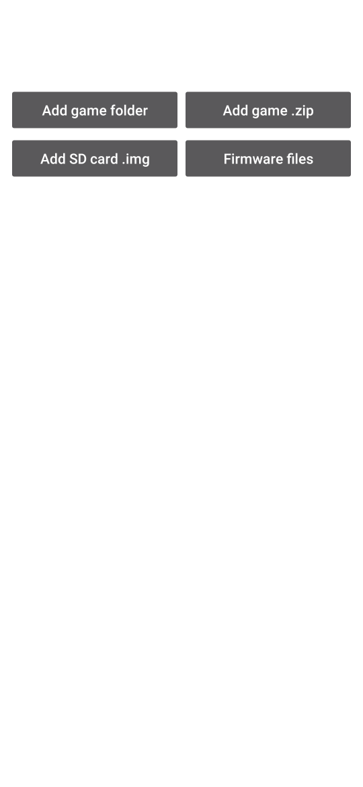
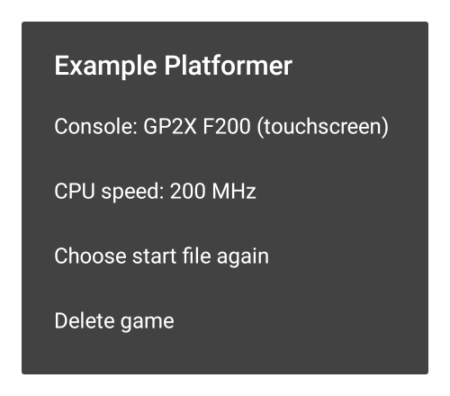
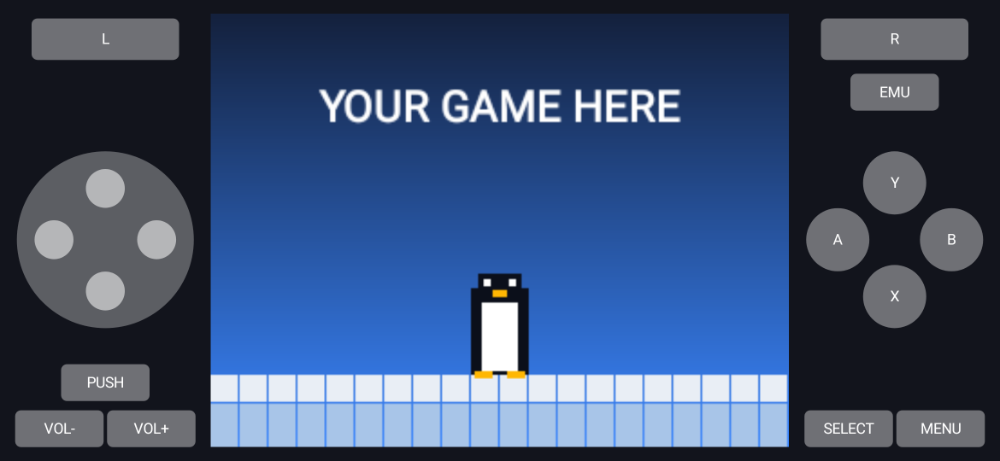

# PocketPenguin

An Android emulator for the GamePark Holdings handhelds: **GP2X F100/F200**, **GP2X Wiz** and **GP2X Caanoo**.

> PocketPenguin is an independent fan project. It is not affiliated with, endorsed by or connected
> to GamePark Holdings or any game publisher. "GP2X", "Wiz" and "Caanoo" are trademarks of their
> respective owners and are used here only to say which consoles' games the emulator runs.
> **No firmware or games are included.** Use it with homebrew, freely released games, or files
> copied from your own console and SD card.

## How it works

All of these consoles run Linux on ARM, and their games are ordinary Linux ARM programs (`.gpe`).
PocketPenguin runs them like `qemu-user` does. It does **not** boot a firmware image:

- **CPU**: the ARM926EJ-S interpreter from PocketSprout. It runs ARMv4T (F100/F200) and ARMv5TE
  (Wiz/Caanoo) code, ARM and Thumb.
- **Kernel**: `core/src/linux.cpp` emulates Linux at the system call level. That covers both the old ABI (OABI,
  `swi 0x9000xx`) used by GP2X-era toolchains and EABI. It handles files, mmap/brk, threads (clone + futex),
  signals, pipes, poll/select, timers and the ARM kuser helpers. It loads static and dynamic ELF programs and
  follows `.gpe`/`.gpu` launcher shell scripts. SD card paths are case-insensitive, like the real FAT card.
- **Hardware** (`core/src/gp2x.cpp`):
  - F100/F200: MMSP2 registers through `/dev/mem`. That includes the MLC display layer (16/8/24 bpp, palette,
    scaling), the display controller, the 2D blitter (raster ops, transparency, patterns), the GPIO buttons,
    the vsync line and the 7.37 MHz TCOUNT timer.
  - Wiz/Caanoo: Pollux registers. That includes the MLC layers (same layout as the LF1000 in PocketSprout),
    the DPC vsync flag and the timers.
  - Devices: `/dev/fb0`, `/dev/GPIO`, `/dev/dsp` (OSS), `/dev/mixer`, the F200 touchscreen, the Wiz/Caanoo
    touchscreen (`/dev/input/event0`, read through tslib) and the Caanoo joystick (`/dev/input/js0`).
- **3D (Wiz/Caanoo)**: calls into the firmware's `libopengles_lite.so` are trapped and run by an OpenGL ES 1.1
  software renderer. That's the same renderer PocketSprout uses, because the Wiz has the same GA3D 3D engine as
  the LeapFrog Didj.
- **FPA floating point**: old toolchains (e.g. the Wiz firmware's glibc) use FPA instructions, which the
  real kernel emulated in software. `core/src/fpa.cpp` does the same.
- **Timing**: time is virtual and driven by the emulated CPU clock. Programs that busy-wait on vsync are
  fast-forwarded, so a game's speed stays correct even when the phone is slower than the real console.

SDL 1.2 games work through the standard fbcon / OSS / joystick paths, and through GP2X "HW SDL" (direct
register access and the blitter). Old LinuxThreads-based programs work too, where each thread acts as its own
process.

Tested with real games:
- **Go Bear Go!** (GP2X, Fenix engine): intro, title, menu and level 1, with music.
- **Deicide 3** (Wiz, dynamically linked against the Wiz firmware 1.2.6 libraries): intro cutscenes, story and
  sound. Its full-motion video is CPU-heavy, because the Wiz ran it at 533 MHz.
- **Propis** (Wiz, OpenGL ES + touchscreen): logo, title, touch menus and music.
- Wiz Toaplan ports (Demons World, Out Zone, Snow Bros 2, Twin Cobra, Zero Wing) boot to their attract screens.

## Getting started

**1. Install.** Download the APK from the latest build (GitHub **Actions** → *Build* → artifact
`PocketPenguin-apk`) and open it on your phone.

**2. Add games.** Copy your games to the phone first. Then use one of:
- **Add game folder**: pick a game's folder, the one with the `.gpe` and its data files.
- **Add game .zip**: the same folder, zipped.
- **Add SD card .img**: imports every game from a whole SD card dump (FAT12/16/32), also inside a
  `.zip`. The GPH menu `.ini` files on the card are used to pick each game's start file.



**3. Check the options (optional).** The console model is guessed from the program
(static old-ABI → GP2X, dynamic old-ABI → Wiz, EABI → Caanoo). Long-press a game to change the
model, the emulated CPU speed, or which file starts it, or to delete it.



**4. Firmware files (only some games).** Games linked against the console's own system libraries
need them: tap **Firmware files**, choose the console, and pick a folder or zip with `lib/`,
`usr/lib/` etc. copied from your own device.

**5. Play.** Tap a game. The on-screen D-pad, A/B/X/Y, L/R, START/SELECT (MENU on the Wiz,
HELP1/HELP2 on the Caanoo), VOL−/VOL+ and stick push (Caanoo: HOME) work like the real buttons.
On touchscreen models, touching the game picture is the touchscreen. Gamepads work too.
**EMU** opens the emulator menu: *Show log* (the game's output, useful for bug reports),
*Restart game* and *Quit game*.



*The screenshots are rendered from the app's own code off-device; the library entries and the
picture on the screen are placeholders, not real games.*

## Desktop runner

```
g++ -O2 -std=c++17 -o gp2xcli tools/gp2xcli.cpp core/src/*.cpp
./gp2xcli --model wiz --root FIRMWARE_DIR --mount /mnt/sd=GAMES_DIR -f 600 -o shot.ppm /mnt/sd/game/game.gpe
```
Options: `--strace` logs system calls, `-k FRAME:MASK` presses buttons, `--wav out.wav` saves the audio.
Tests: `tests/run_tests.sh ./gp2xcli` (needs `gcc-arm-linux-gnueabi`).

## Not done yet

- The F100's second CPU (ARM940T), which some emulators use for sound.
- `fork()`/`system()`.
- Games sold through the GPH store (INKA DRM, e.g. Deicide 3 and the Toaplan ports). Their licence sits in a
  protected area of the original SD card that a card dump doesn't contain. The emulator reports this.
- YUV video layers, TV out, and networking.
- A JIT. The interpreter runs at about 80–100 MIPS on a desktop, so a lower CPU speed setting can help on phones.

## Credits

- The ARM926 CPU core and the OpenGL ES renderer are shared with **PocketSprout**, the LeapFrog
  Didj emulator.
- The GP2X homebrew community's documentation and example code for the MMSP2 and Pollux hardware
  (the hardware test in `tests/guest/hwtest.c` follows Rlyeh's "minimal library" style).
- **[Unicorn](https://www.unicorn-engine.org)** is used in testing only, as the reference CPU the
  ARM core is fuzz-tested against. It isn't part of the app.
- **[Robolectric](https://robolectric.org)** (MIT) renders the tutorial screenshots in tests.

## AI use

PocketPenguin was built with heavy use of AI. Most of its code and documentation was written by
Anthropic's Claude, working from my direction, testing and review. It has been tested with the
games listed above, but it hasn't had the years of use that long-established emulators have, so
please report anything that doesn't work.

## Licence

PocketPenguin is free software: you can redistribute it and/or modify it under the terms of the
GNU General Public License as published by the Free Software Foundation, either version 3 of the
License, or (at your option) any later version. It is distributed WITHOUT ANY WARRANTY; see
[LICENSE](LICENSE) for the full text.

Copyright (C) 2026 Hcode91
